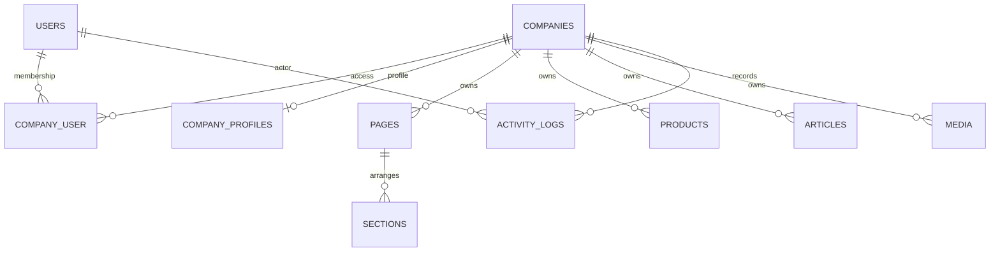

# Keputusan arsitektur dan tahap implementasi

## 1. Kondisi repository

Target `projects/backend-rbi` adalah Laravel React starter kit, Laravel ^13.17, PHP ^8.3, Inertia ^3, Fortify ^1.37, PHPUnit 12, PHPStan/Larastan level 7, dan Pint. Kode sebelumnya menangani user, team, invitation, auth, serta settings. Tidak ada domain company profile. Tidak ditemukan AGENTS.md yang berlaku pada jalur target. Banyak perubahan di repository induk sudah ada sebelum pekerjaan ini; semuanya dipertahankan. Folder projects diabaikan oleh Git induk; file tetap tersedia di workspace.

File integrasi terkait: User (flag super admin + relasi membership), AppServiceProvider (konteks perusahaan/rate limit), bootstrap/app.php (JSON error API), filesystems.php (disk privat), routes/web.php (include routes CMS), .env.example. Composer dan alur auth/team yang ada tidak diganti. TestCase memakai withoutVite agar suite backend dapat berjalan tanpa manifest frontend; assertion response/auth starter tetap dijalankan. DatabaseSeeder starter tidak diubah. Migration baru bersifat additive.

## 2. Keputusan

- Pertahankan Laravel 13 yang sudah stabil dan terpasang; PHP minimal 8.3. Satu aplikasi dan database MySQL/MariaDB; tidak ada database per tenant.
- Company merupakan domain terpisah dari Team starter. Membership team **tidak** memberikan akses CMS perusahaan. Satu user boleh memiliki beberapa company dan role berbeda.
- Filament 5 dievaluasi sebagai pilihan utama untuk proyek panel baru: CRUD dan form cepat, tetapi tetap perlu scope/policy server serta audit komponen Livewire. Repository ini sudah memiliki Inertia/Fortify/team. Untuk permintaan backend MVP, pilih API dan fondasi Inertia yang ada sehingga tidak menambahkan panel kedua atau migrasi auth. Panel company khusus belum diimplementasikan; UI berikutnya memakai kontrak ini. Jika memilih Filament kemudian, resource wajib memakai CompanyContext dan CompanyPolicy yang sama, jangan mengganti isolasi dengan filter UI.
- Session Fortify + CSRF untuk CMS same-origin. Tidak menambahkan token autentikasi sendiri atau JWT. Akses machine-to-machine/private lintas origin membutuhkan Sanctum dan rancangan CORS tersendiri di tahap berikutnya. API publik anonim dapat dipakai server frontend langsung.
- Editor mengelola draft/archived, admin perusahaan mengelola profil/tema dan publikasi. Editor tidak bisa mengubah/hapus konten berstatus published, termasuk konten yang masih dijadwalkan atau section pada halaman published. Super admin mengelola perusahaan, aktivasi, pengguna dan membership. Company admin tidak dapat memberi dirinya role global.
- `active=true` **dan** company `status=published` diperlukan untuk seluruh API publik. Konten hanya tampil saat published dengan jadwal kosong atau sudah lewat. Product juga harus visible; section visible hanya tampil dari halaman published.
- Profil mengikuti publikasi company. Mengedit profil company published langsung mengubah tampilan publik; gunakan draft pada company sebelum revisi besar. Belum ada revision workflow. Published article/page/product juga berubah langsung jika diubah oleh admin.
- Body/description berupa teks biasa; tema dan section JSON memakai allowlist server. Tidak ada HTML, CSS, JS, font URL, embed atau template source pengguna. Frontend harus merender sebagai teks, memakai CSS variables yang aman, dan tidak memakai dangerouslySetInnerHTML.
- File privat, maksimal 5 MiB, JPEG/PNG/WebP; SVG ditolak. URL file diproksikan lewat pemeriksaan membership atau referensi konten publik. Gambar yang dipakai di profil/halaman/konten publik dapat diakses anonim; file draft yang belum dipakai publik tidak bisa. Satu file yang dipakai bersama draft dan published tetap publik.
- `plan_key` dan `feature_limits` menyiapkan paket masa depan. Batas jumlah pages/products/articles/media opsional diterapkan saat create; lock baris company mencegah dua writer melewati batas secara bersamaan pada InnoDB. Ini bukan billing. Tidak ada limit keras untuk jumlah company.
- Company dihapus secara soft delete agar dapat dipulihkan operator. Konten/media tetap ada dan tersembunyi; tidak dilakukan purge file otomatis. Penghapusan user oleh super admin menghapus sessions dan membership. Activity menyimpan actor, action, subject dan nama kolom berubah, tanpa password atau isi data legal.

Sumber versi: [Laravel release notes](https://laravel.com/framework/docs/releases), [Filament installation](https://filamentphp.com/docs/5.x/introduction/installation).

## 3. Database dan relasi

Migration `2026_10_01_000001_create_company_cms.php` menambahkan:

| Tabel | Field/relasi utama |
| --- | --- |
| users | is_super_admin boolean default false; auth/password/two-factor starter dipertahankan |
| companies | name, slug unik global, active default false, status draft, plan_key, feature_limits JSON, soft delete |
| company_user | company_id, user_id, role; pasangan unik; banyak-ke-banyak |
| company_profiles | company_id unik; description, address, email, phone, whatsapp, opening_hours/social_links/legal/theme JSON, meta_title/meta_description, logo/cover/share_media_id |
| pages | company_id, title, slug, body, status, published_at, SEO, image_media_id |
| products | seperti pages + kind product/service, category, price decimal(15,2) nullable, visible |
| articles | seperti pages, published_at mendukung jadwal opsional |
| sections | company_id, page_id, type, position, visible, config JSON, image_media_id |
| media | company_id, disk, path, mime, size, alt |
| activity_logs | company_id nullable untuk aksi pusat, actor_id nullable, action, subject_type/id, changes JSON, timestamp |

Unique `(company_id, slug)` memungkinkan slug sama antarperusahaan; index `(company_id,status,published_at)` membantu query publik. Semua tenant child memiliki FK company. Referensi media dan section→page memakai FK gabungan `(company_id, target_id)` sehingga SQL langsung juga tidak dapat membuat referensi silang. Section ikut dihapus saat page dihapus. Media yang masih direferensikan tidak dapat dihapus (409). Relasi ORM company↔users, company.profile, record.company, page.sections, section.page menggunakan scope yang sama. Profil/legal bukan data autentikasi; legal tidak diserialisasi pada endpoint publik.

## 4. Isolasi di server

1. `ResolveCmsCompany` mengambil company melalui `Company::accessibleTo(user)` untuk CMS atau `publiclyVisible()` + slug untuk publik; akses silang menghasilkan 404 sebelum membaca konten.
2. `CompanyContext` scoped per request berisi ID company dari server. Middleware selalu mengosongkannya pada finally. Worker/command/seeder harus menetapkan konteks secara eksplisit dan membersihkannya.
3. Semua tenant model mewarisi `CompanyRecord`: global scope company. Tanpa konteks query selalu menghasilkan nol record; create tanpa konteks gagal. Company_id berasal dari konteks server saat create dan tidak boleh dipindahkan saat update. Super admin tetap scoped pada endpoint per company.
4. Controller memakai ID/slug mentah yang dibatasi route, lalu `findOrFail` melalui model scoped. Tidak memakai route-model binding global yang dapat mengambil data perusahaan lain sebelum middleware berjalan.
5. Form Request melarang company_id/id/actor_id, memvalidasi media dan page_id dengan company_id server, serta membatasi key pada seluruh JSON configuration.
6. `CompanyPolicy` mengontrol view/update/editContent/publish/create/delete. Validasi status dan pemeriksaan konten lama menutup upaya editor mengedit published tanpa menyertakan field status.
7. API Resource membuang disk/path/legal publik. Route file mengulang pemeriksaan company dan referensi yang boleh tampil; tidak ada URL storage mentah.
8. Activity endpoint pusat adalah satu read yang secara eksplisit melepas scope setelah super admin diperiksa. Audit pusat menulis company_id null dari server. Seeder/test menggunakan scope bypass hanya untuk assert agregat; jangan meniru pola itu pada endpoint tenant.

Raw DB queries tidak memiliki global scope. Hindari raw SQL pada domain company kecuali setiap query memiliki company_id yang terverifikasi. Soft deleted company tetap mempunyai child; jangan query child tanpa terlebih dahulu memeriksa akses/visibility company. Developer yang menambah endpoint/model baru harus memakai pola yang sama dan menambah test isolasi.

## 5–8. MVP dan pengalaman pemilik UMKM

Backend menyediakan CRUD company/profil/pages/products/articles/sections/media, user dan membership pusat, log aktivitas, publikasi/jadwal, serta API publik dengan pagination. Demo dan test tersedia terpisah.

Rancangan form untuk panel berikutnya:

- Mulai dari pilihan usaha dan template Simple/Katalog/Layanan; tampilkan nama usaha, deskripsi singkat, kontak dan logo terlebih dahulu.
- Halaman tab Beranda/Tentang/Produk atau Layanan/Galeri/Kontak; tambahan page melalui title dan slug. Harga dan legal ditandai opsional. Field API `title` menjadi label “Nama produk/layanan” untuk product.
- Harga Rupiah dikirim sebagai decimal tanpa pemisah ribuan; null untuk “Hubungi kami”. Jam menggunakan hari mon–sun, waktu HH:mm, opsi closed. WhatsApp petunjuk “Gunakan kode negara 62, contoh format 628…”.
- Template hanya enum. Font system/inter/noto-sans; warna hex #RRGGBB. Section hero/text/products/gallery/contact/articles, urutan position, toggle visible, config heading/text/button_label/button_url/limit. Gallery dapat berisi beberapa section bergambar.
- Tombol Simpan draft/Publikasikan/Arsipkan. Jadwal ditampilkan WIB/WITA/WIT oleh UI, dikirim ISO-8601 dengan offset dan disimpan UTC (normalisasi pada request). Label “Belum tayang” jika jadwal di masa depan; status draft disimpan jika belum dipilih.
- Petunjuk upload “JPG, PNG, WebP maksimal 5 MB”; preview lokal dan alt. Validasi server mengembalikan errors per field berbahasa Indonesia. Field utama mempunyai batas panjang yang eksplisit di API.

## 9. Operasional dan risiko

- Backup harian database **dan** file media privat; simpan terenkripsi di lokasi berbeda, batasi akses, uji restore berkala. Backup DB saja tidak memulihkan gambar.
- Deploy additive: backup, `php artisan migrate --force`, cache konfigurasi/routes, smoke test CMS dan publik. Jangan menjalankan migrate:fresh di database aplikasi. Down migration menghapus tabel CMS dan hanya digunakan di lingkungan disposable.
- Gunakan HTTPS, secure cookies, APP_DEBUG=false, key tetap, permission storage minimum. Log daily dengan rotasi; exception internal dilaporkan oleh Laravel tetapi detail SQL tidak muncul di response API.
- Rate limit CMS 120/menit/user, publik 60/menit/IP; Fortify login 5/menit/email+IP. Gunakan shared cache jika menambah beberapa instance.
- Jadwal publikasi diperiksa pada query sehingga tidak perlu cron untuk perubahan status. Normalisasi UTC penting; server/DB pakai UTC. Tidak ada purge/queue tambahan pada MVP.
- Adapter S3 kini terpasang; bucket harus privat. Tidak ada image processing/strip EXIF otomatis, audit revision diff atau antivirus pipeline pada MVP. File dihapus setelah transaksi metadata selesai; kegagalan storage deletion perlu ditelusuri lewat log dan pembersihan operator.
- Soft delete company menahan data/file sampai proses retensi operator. Pengguna dengan banyak membership tidak berhak melihat company lain tanpa membership tersebut. Akses revoked berlaku pada request berikutnya.
- Suite SQLite mengecek domain/security; MySQL/MariaDB staging diperlukan untuk constraint engine/index dan concurrency lock. Jangan menganggap keberhasilan SQLite sebagai verifikasi produksi MySQL.

Optimasi storage dan query tahap lanjutan, termasuk konfigurasi S3/R2 serta perubahan list payload, tersedia di [optimization.md](optimization.md).
