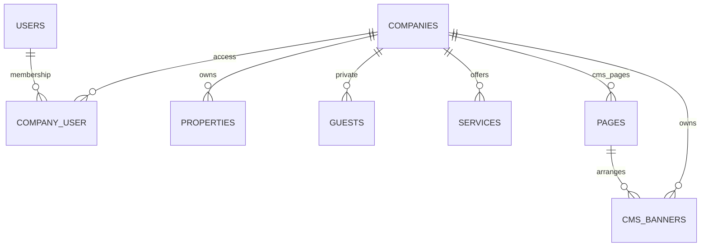

# Delta ERD brand/outlet

Root tenant tetap `companies` dan role per tenant tetap pivot `company_user`. Brand adalah istilah API/UI. Tidak ada duplikasi root, perubahan ID integer, migrasi/reset database, perubahan auth atau role baru.

| Tabel | Delta |
| --- | --- |
| companies | domain nullable unique global, logo_url nullable, settings JSON nullable |
| properties | integer ID, company FK, name/address/phone/status, timestamps, soft delete; index company/status/id |
| guests | integer ID, company FK, first_name/last_name/email/phone, timestamps; index company/id; admin-only private |
| services | integer ID, company FK, name/icon/description/status, timestamps; index company/status/id |
| cms_banners | integer ID, company FK, page_id, image_url/title/link_url/position/status, timestamps; index company/page/status/position |

Banner→page composite FK `(company_id,page_id)` → `pages(company_id,id)` menutup cross-tenant references bahkan pada SQL langsung; hard delete page menghapus banners. Company hard delete cascade child; normal Company DELETE tetap soft sehingga middleware menyembunyikan seluruh child. Property DELETE soft; guest/service/banner DELETE hard.

Semua model baru inherit CompanyRecord: fail-closed tanpa konteks; company_id diisi server, ownership immutable. Routes reuse ResolveCmsCompany dan CompanyPolicy. Guests tidak masuk route public dan read pun harus policy update (admin). Public settings memakai allowlist request **dan** allowlist resource untuk data legacy. Public property/service/banner query status tidak memakai inherited published() karena tabel-tabel ini tidak punya published_at; hanya page banner memakai jadwal publication existing.

Banners mengunci page asal/tujuan dan mengecek publish permission seperti sections. Audit mencatat action, actor, subject ID dan nama field, bukan nilai PII. Tidak ada quota baru untuk outlet resources. Logo/banner HTTPS URL disimpan sebagai URL eksternal, tidak di-download server. Domain merupakan metadata, bukan trust terhadap Host header atau provisioning domain.

Frontend melakukan pemuatan page terpilih melalui page-delivery endpoint dan banner terpisah lewat page_id. Service/property lists paginated terpisah; tidak perlu menambah section_types/config untuk backend CRUD ini.
