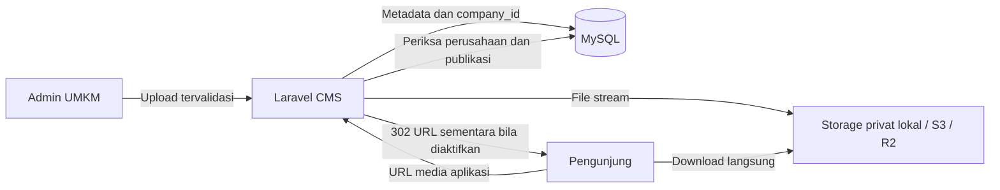

# Struktur optimasi CMS UMKM

File gambar disimpan di object storage privat; database menyimpan metadata dan foreign key. Untuk awal hingga 10 perusahaan, satu Laravel + satu MySQL cukup. Object storage bisa dipilih tanpa mengubah endpoint atau tabel konten.

## Alur dan pembagian penyimpanan



| Data | Tempat | Alasan |
| --- | --- | --- |
| Profil, halaman, produk, artikel, tema, section | MySQL | Bisa divalidasi, dicari, di-scope dan di-backup |
| Binary foto/logo/cover | Storage privat | Tidak membesarkan database atau buffer query |
| Metadata gambar | Tabel media: company_id, disk, path, mime, size, width, height, alt | Relasi aman dan informasi layout tanpa membaca file lagi |
| Session/cache/queue | Database pada MVP; Redis opsional saat trafik meningkat | Hindari menambah service sebelum diperlukan |
| Asset frontend JS/CSS | Build Vite; CDN statis opsional | Bisa di-cache terpisah dari konten yang memiliki status publikasi |

Tidak menyimpan BLOB, base64, atau signed URL di database. Signed URL memiliki masa berlaku dan selalu dibuat saat akses. Path object berupa nama acak buatan server, bukan nama/path dari pengguna.

Struktur object yang sekarang dipakai:

```text
companies/{company_id}/originals/{random-file-name}.jpg
companies/{company_id}/originals/{random-file-name}.png
companies/{company_id}/originals/{random-file-name}.webp
```

Struktur tambahan saat pengolahan gambar dibutuhkan (belum dibuat pada tahap ini):

```text
companies/{company_id}/variants/{media_id}/{version}/thumb.webp
companies/{company_id}/variants/{media_id}/{version}/card.webp
companies/{company_id}/variants/{media_id}/{version}/hero.webp
```

## Optimasi yang sudah diterapkan

1. Adapter Flysystem S3 terpasang di composer.json/lock. Disk `cms_cloud` menggunakan driver S3 yang dapat diarahkan ke R2, AWS S3, atau layanan yang kompatibel. Disk lokal `cms` tetap default agar tidak membutuhkan cloud credential untuk development.
2. Bucket/disk CMS wajib privat. Upload menerima JPEG/PNG/WebP maksimal 5 MiB, dimensi maksimal 8000×8000; width/height disimpan agar frontend bisa menetapkan ukuran gambar dan menghindari pergeseran layout.
3. Upload file dijalankan **sebelum** transaksi metadata dan lock company. Transfer cloud yang lambat tidak menahan lock database. Pemeriksaan quota tetap dilakukan di dalam transaksi dengan row lock; jika gagal, file yang sudah terkirim dibersihkan. Kegagalan cleanup dilaporkan dan tidak menutupi error awal.
4. Semua konten tetap mereferensikan media_id; mengganti storage tidak mengubah relasi company. File lama memakai disk yang tercatat pada masing-masing record, bukan disk default yang baru.
5. Pengiriman cloud punya mode proxy dan temporary_url. Pada temporary_url, Laravel memeriksa akses lalu membuat URL HTTPS berumur pendek; file di-download langsung dari object storage. Tidak melakukan HEAD tambahan sebelum redirect. Jika object hilang, provider yang mengembalikan 404.
6. Redirect dan response file memakai private/no-store. Draft, company inactive dan akses lintas perusahaan diperiksa sebelum URL dibuat. Tidak ada cache publik untuk route CMS, JSON publik, atau media endpoint yang dapat menampilkan draft setelah unpublish.
7. Daftar pages/products/articles CMS dan publik menggunakan SELECT field ringkas, tanpa body LONGTEXT. Endpoint detail tetap mengirim body. Pagination default 20, maksimum 100. Frontend yang sebelumnya membaca body dari list harus mengambil endpoint detail.
8. Pengecekan referensi media publik memakai satu query EXISTS dengan UNION ALL. Setiap cabang tetap memakai company scope, status/jadwal dan visibility. Tidak lagi mengirim sampai lima query terpisah per file.
9. Migration optimasi menambahkan index gabungan untuk media publik, daftar produk published/visible, dan urutan section visible. Index lama tetap ada; ini menjaga migration additive dan rollback sederhana. Index tambahan memakai ruang dan menambah biaya write; evaluasi EXPLAIN pada MySQL staging sebelum menghapus index yang overlap.

Pemindahan upload keluar transaksi menghindari lock panjang, tetapi proses yang mati setelah upload dan sebelum metadata tersimpan bisa menyisakan object yatim. Pembersihan quota/error sudah ada; object yatim akibat process crash ditinjau operator sebelum penghapusan. Jangan menetapkan lifecycle rule yang menghapus seluruh originals berdasarkan umur karena file published bisa sudah lama.

## Konfigurasi cloud

Isi environment deployment sendiri; credential tetap kosong pada source. Adapter sudah terpasang, tidak perlu package tambahan untuk mode S3/R2.

Contoh **R2**, gunakan endpoint HTTPS milik akun dari dashboard penyedia:

```dotenv
CMS_MEDIA_DISK=cms_cloud
CMS_CLOUD_ACCESS_KEY_ID=
CMS_CLOUD_SECRET_ACCESS_KEY=
CMS_CLOUD_BUCKET=
CMS_CLOUD_REGION=auto
CMS_CLOUD_ENDPOINT=
CMS_CLOUD_USE_PATH_STYLE_ENDPOINT=false
CMS_CLOUD_DELIVERY=temporary_url
CMS_MEDIA_URL_TTL_SECONDS=60
```

Untuk **AWS S3**, isi region bucket (contoh us-east-1), biarkan endpoint kosong agar SDK memakai endpoint AWS, dan isi key/secret/bucket dari environment aman. Bucket tidak dibuka publik. Tidak ada cloud resource atau akun yang dibuat oleh perubahan kode ini.

Setelah konfigurasi:

```bash
composer install
php artisan migrate
php artisan config:cache
# Restart worker jika kelak queue dipakai.
```

Migration menambah width/height nullable sehingga data media lama tetap valid; metadata dimensi lama tidak dibaca otomatis. Mengubah CMS_MEDIA_DISK hanya memindahkan tujuan upload **baru**. File lama tetap berada di disk sebelumnya. Untuk migrasi file lama, salin dan verifikasi ukuran/hash per company sebelum mengganti metadata disk/path; jangan menghapus lokal sebelum verifikasi backup.

### Pilihan delivery dan pencabutan akses

| Mode | Beban server Laravel | Perilaku pencabutan akses |
| --- | --- | --- |
| proxy (default) | Laravel meneruskan byte file secara streaming | Setiap permintaan baru diperiksa; tidak ada signed URL eksternal yang tersisa |
| temporary_url | Laravel hanya memeriksa akses dan memberi redirect; transfer di cloud | URL yang sudah diberikan masih berlaku hingga TTL, default 60 detik (dibatasi 15–300 detik) |

Signed URL adalah bearer link: jangan mencatat query signature ke analytics/log publik dan jangan membagikan URL CMS. Mode proxy dipertahankan sebagai default untuk menjaga perilaku pencabutan langsung. Aktifkan temporary_url jika kebutuhan mengurangi transfer Laravel lebih penting daripada pencabutan dalam rentang TTL tersebut.

Presigned URL R2 menggunakan domain API S3 dan bukan custom domain CDN. Tidak menganggap opsi ini sebagai implementasi CDN. CDN untuk media membutuhkan Worker/edge yang memeriksa hak/status dan strategi purge, atau namespace derivative publik yang hanya berisi konten published. Jangan mengaktifkan Cache Everything pada endpoint media/CMS untuk mengejar performa.

Sumber: [Laravel storage/temporary URLs](https://laravel.com/framework/docs/filesystem), [R2 S3 compatibility](https://developers.cloudflare.com/r2/get-started/s3/), [R2 presigned URLs](https://developers.cloudflare.com/r2/api/s3/presigned-urls/).

## Tahap berikutnya saat jumlah gambar atau pengunjung meningkat

Rancangan ini menyiapkan jalur optimasi, tetapi resize/compression otomatis, Redis, CDN media dan worker image **belum diimplementasikan atau diaktifkan**.

- Pengolahan gambar lewat queue: thumbnail 320 px, card 800 px, hero 1600 px, tanpa upscale; WebP quality sekitar 80 sebagai titik awal lalu nilai mutu visual pada foto UMKM. Simpan original privat dan derivative berversi. Worker perlu batas memory/time, pixel budget dan driver GD/Imagick atau library yang dipilih. Jangan memproses foto 8000×8000 dalam request web.
- Pindahkan queue ke Redis jika jobs banyak; pakai database queue dulu bila cukup. Jalankan worker khusus media (`--queue=media --sleep=3 --tries=3 --timeout=60`) setelah job media nyata tersedia; set retry_after lebih besar dari timeout. Worker belum diperlukan oleh kode saat ini.
- Cache profil/list publik memakai key `company:{id}:version:{version}:...`. Setiap perubahan publikasi/profile/section harus meningkatkan version **setelah commit**. TTL juga dibatasi waktu publikasi terjadwal terdekat. Pemeriksaan company active tetap dilakukan. Jangan menambahkan Cache::remember panjang tanpa invalidation dan batas jadwal karena bisa membocorkan konten archived atau menunda artikel terjadwal.
- Frontend memakai lazy loading untuk gambar di bawah fold, width/height dan srcset derivative setelah tersedia; foto hero utama dapat dimuat lebih awal. Tetapkan anggaran ukuran gambar per halaman dan audit dari jaringan seluler.
- Pantau latency API p95, jumlah query, ukuran response, lock wait, byte storage, error upload/cleanup dan antrean. Gunakan pagination/cursor dan full-text search hanya jika ukuran data membuat OFFSET/LIKE mahal. Saat ini tidak menambahkan search service atau microservice.
- Backup DB dan object storage terpisah. Catat bytes storage per company untuk batas paket masa depan; jangan menghitung seluruh bucket pada setiap request.

Runtime: Laravel 13 mendukung PHP 8.3 pada framework, tetapi composer.lock repository saat ini memuat Symfony 8.1 yang membutuhkan PHP ≥8.4.1. Gunakan PHP 8.5 seperti lingkungan test untuk lock yang sekarang; jangan menganggap composer install pada PHP 8.3 sudah terverifikasi.
